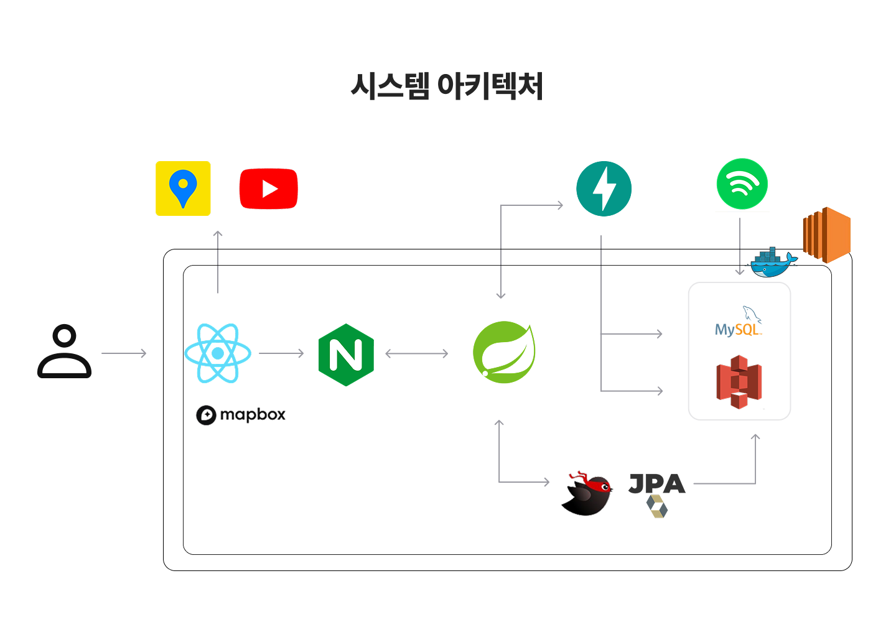
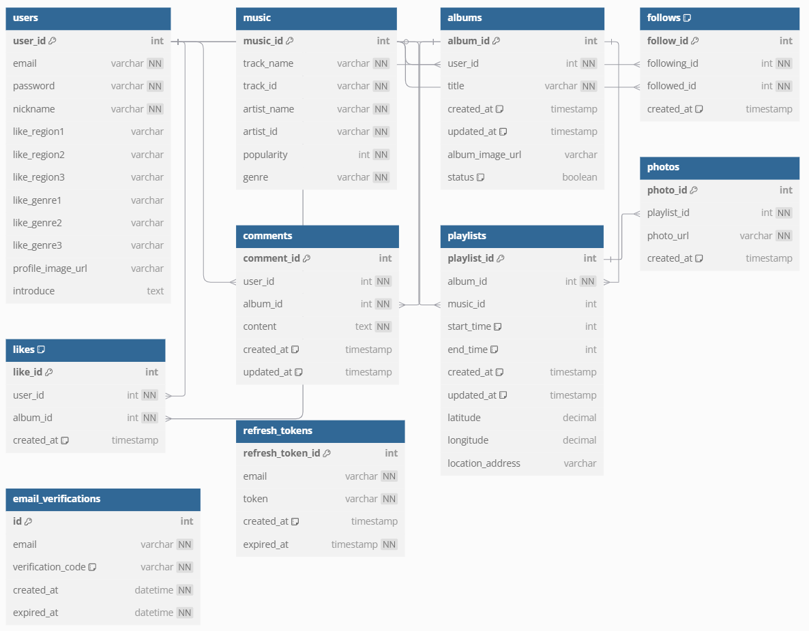

# 🎧 몽땅 - 음악과 함께하는 추억 여행

## 목차
[1. 서비스소개](#1-서비스소개)

[2. 기능소개](#2-기능소개)

[3. 주요기능 상세소개](#3-주요기능-상세소개)

[4. 기술스택](#4-기술스택) 

[5. 협업 툴](#5-협업-툴)

[6. 시스템 아키텍쳐](#6-시스템-아키텍쳐)

[7. ERD](#7-erd)

[8. 시연영상](#8-시연영상)

[9. 팀 구성원 및 역할](#9-팀-구성원-및-역할)


## 1. 서비스소개
```
음악과 함께 추억을 회상하고 싶은 누구나!
다녀간 곳을 한번에 보는 나만의 여행 지도!
내가 올린 사진과 내가 선택한 음악을 통해 AI가 만들어주는 나만의 앨범 이미지! 
```
### 1) 기획배경

**"프루스트 현상"** 에 대해 아시나요? 프루스트 현상은 맛과 향기와 같은 감각이 과거의 일을 기억해내는 현상을 말합니다. 

음악 또한 같은 역할을 합니다. 지친 일상에서 벗어나 여행을 다니며 노래를 들으며 힐링을 하고 그 순간의 소중한 추억을 사진으로 남깁니다. 이러한 추억은 지친 일상을 위로합니다.

이런 소중한 추억을 노래와 함께 기억할 수 있다면 더 또렷할 것입니다. 지친 일상에서 즐거운 추억을 소환할 수 있게 하고자 서비스를 기획했습니다.


## 2. 기능소개

### 1) 나만의 앨범 

- 나의 소중한 추억 사진을 노래와 함께 저장해 보세요.
- 여행을 다니며 중간중간 나의 플레이리스트를 만들고 저장할 수 있습니다.
- 여행이 끝나고 나만의 앨범을 완성해 보세요
- 완성한 나의 앨범을 통해 사진과 노래를 통해 추억을 회상할 수 있습니다.

### 2) AI가 만들어주는 나만의 앨범 이미지

- AI가 만들어주는 나만의 앨범 이미지를 만들어 보세요.
- 앨범을 완성했을 때 업로드 된 사진을 통해 어울리는 앨범 표지를 만들어 드립니다.

### 3) 앨범 추천

- 다른 사람들의 앨범에는 어떤 사진과 어떤 음악이 있는지 확인할 수 있습니다.
- 유저 기반 추천시스템을 통해 나와 비슷한 사람들이 좋아한 앨범을 확인할 수 있습니다.
- 다른 사람은 어떤 장소에서 어떤 음악을 떠올렸는지 확인해 보세요.

### 4) 한번에 보는 나의 여행지

- 여행 중 내가 다녀간 곳을 한눈에 살펴보세요.
- 여행 중 방문한 장소를 노래와 사진과 함께 저장해보세요.
- 지도를 통해 그 장소에서는 어떤 노래를 들었는지 확인할 수 있습니다.

## 3. 주요기능 상세소개
### 1) 생성형 이미지 AI

1. 사용자가 생성 완료한 앨범에 포함된 사진들 중 한 장을 선택합니다.
2. BLIP 모델을 통해 사진을 설명하는 캡션을 추출합니다.
3. 추출한 캡션을 Stable Diffusion의 입력 프롬프트에 포하하여, 선택된 사진의 내용이 반영된 이미지가 생성됩니다.

- 모델 선정 이유
1. BLIP과 BLIP-2 모델을 비교했을 때 BLIP-2 모델은 더 자세한 캡션을 추출하지만 약 5초 가량의 시간이 소요됐지만 BLIP 모델은 조금 더 단순한 캡션을 추출하지만, 0.9~1.3 초의 시간이 소요됐습니다. 이미지 생성 프롬트프로 사용하기에는 비교적 단순한 내용이 결과가 더 좋았기 때문에 최종 결과물의 결과와 성능을 고려했을 때 BLIP 모델을 사용했습니다.
2. Stable DIffusion v1-5 모델을 사용한 이유는 Stable Diffusion XL base 1.0과 Stable Diffusion XL turbo 등의 모델은 해상도 높은 이미지를 생성해주지만 훨씬 더 많은 시간이 소요됐습니다. 전체적으로 생성된 이미지의 분위기와 시간을 비교했을 때 v1-5이 적합하다고 생각해 해당을 모델을 사용했습니다.

### 2) 앨범 추천

1. 특정 사용자가 좋아한 게시글에서 방문한 장소, 선택한 음악의 장르 등의 데이터들이 존재하며, 이들 간의 상호작용이 발생합니다.
2. xDeepFM 모델을 사용해 자동으로 특징 조합을 설계해 데이터 내에 존재하는 상호작용을 학습합니다.

- 모델 선정이유
1. 기존의 Factorization Machien과 딥러닝 기반 모델들의 장점을 결합하여, 특징 사이의 복잡한 상호작용도 효과적으로 학습할 수 있다고 판단해 해당 모델을 선정했습니다.


### 3) MapBox
1. 전체 서비스 색상 팔레트를 고려한 커스터마이징 지도를 사용해 통일감 있는 디자인을 선사합니다. 
2. 위도와 경도 데이터를 통해 사용자가 다녀간 곳을 Maker로 표시합니다. 
3. Maker와 팝업을 통해 해당 장소에서 어떤 노래를 들었는지 확인할 수 있습니다.
4. 사용자의 편의를 고려하여 지도 확대 및 축소 이벤트를 감지하여 상세 정보를 제공합니다.

## 4. 기술스택
### 1) FE
- Node.js 22.13.1
- React1 18.3.1
- TypeScript 5.6.2
- Recoil 0.7.7
- Vite 6.0.5
- Mapbox-gl 3.9.4
- framerMotion 12.4.3
- react-swipeable 7.0.2
### 2) BE
- JDK 17
- SpringBoot 3.3.7
- Gradle
- Spring web
- Spring dev tools
- Spring Security
- JPA
- MySQL Driver
- Mybatis
- Mysql 8.0
- JWT 0.12.3
### 3) Data
- FastApi
- TensorFlow 2.18.0 
- torch 2.6.0 + cu118
- uvicorn 0.34.0
### 4) Infra
- 컨테이너: Docker (Docker Compose)
- 클라우드 플랫폼: AWS EC2, S3
- 리버스 프록시 & 로드 밸런싱: Nginx
- 네트워크: Tailscale
## 5. 협업 툴
### 1)  Git Lab
### 2) Jira
### 3) Notion
### 4) Figma

## 6. 시스템 아키텍쳐


## 7. ERD


## 8. 시연영상

## 9. 팀 구성원 및 역할
|이름|역할|
|--- |---|
|남우재(팀장&BE)|-|
|조성욱(부팀장&Data)| - PM을 맡으며 전체적인 프로젝트 진행 관리<br>- BLIP, Stable Diffusion v1-5 모델을 통해 생성형 이미지 AI 기능 구현<br>- xDeepFM 모델을 활용해 앨범 추천시스템 기능 구현<br>- FastAPI와 Spring 연결|
|김수민(Infra)|------------|
|김민정(FE)|- 피그마 목업 디자인<br>- 회원(로그인, 회원가입, 프로필 수정 등) 관련 페이지 구현<br>- 소개페이지(애니메이션 활용) 구현<br>- 메인페이지 구현<br>- 좋아요 및 검색 페이지 구현<br>- 유튜브API 활용<br> - UCC 제작|
|김혜민(FE)|- 피그마 목업 디자인<br> - 앨범 생성 및 상세 페이지 구현 <br> - MapBox 라이브러리 활용 및 지도 시각화 <br>- 카카오맵 API 활용한 위치 정보 수집 및 활용 <br> - access token과 refresh token 관리 기능 구현 <br> - 발표 ppt 제작작|
| 조기흠(BE) | - spring security + jwt를 활용한 회원가입 및 인증/인가 구현<br>- 회원가입 시 email 인증(비동기 처리)<br>- AWS S3를 활용한 파일 업로드 기능 구현<br>- 회원, 댓글, 프로필, 팔로우, 좋아요 CRUD<br>- 전체적인 CSS 디자인 작업 참여

## 10. 전체회고


